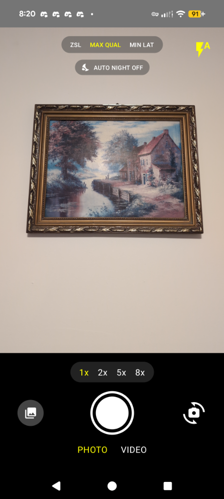
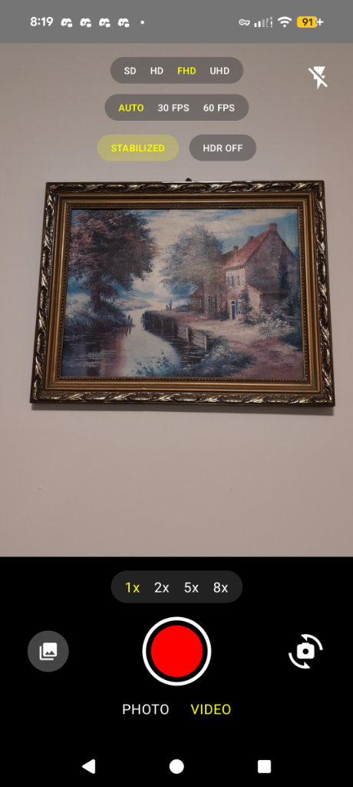

# ProCameraX 📸

[](https://github.com/TejasRajan98/ProCameraX/releases)

ProCameraX is a feature-rich, high-performance Android camera application built using **Jetpack Compose** and **CameraX**. Inspired by Google Camera (GCam), it features a premium dark theme and unlocks advanced hardware capabilities of Android devices.

---

## 🌟 Key Features

### 📸 Photo Mode
- **Auto Night Mode (Night Sight)**: Continuously monitors ambient light levels using the device's light sensor. When lux drops below `10.0f`, it automatically switches the camera pipeline to utilize OEM Night Sight extensions (`ExtensionMode.NIGHT`).
- **Hold Still Progress UX**: During Night Mode capture, a glassmorphic circular progress overlay is displayed showing processing percentage, letting users know exactly when they can move the device.
- **Ultra HDR Support**: Captures and processes Ultra HDR photos on supported Android 14+ devices.
- **Tap to Focus**: Tap anywhere on the preview to focus with an animated target focus ring.
- **Default Flash Auto Mode**: Easy cycling between Flash Auto, On, and Off.

### 🎥 Video Mode
- **10-bit HDR Video**: Capture professional High Dynamic Range (HDR) videos using the HLG10 profile (HEVC format) on supported Android 13+ devices.
- **True Viewfinder HDR Preview**: Employs `SurfaceView` (`PERFORMANCE` mode) and dynamically switches the Android window's color mode to `COLOR_MODE_HDR` so you see real-time HDR contrast directly in the preview.
- **Video FPS Selector**: Force target capture rates (AUTO, 30 FPS, or 60 FPS) bound via Camera2Interop.
- **HDR & 60 FPS Mutual Exclusion**: Prevent stream-binding failures by auto-coercing mutually exclusive capabilities.
- **Video Stabilization**: Native preview and recording stabilization toggle.
- **Torch Support**: Easy spotlight control during recording.

### 🔍 Advanced Zoom
- **Quick Zoom Toggles**: Rapidly jump between `0.5x`, `1x`, `2x`, `5x`, and `10x` magnification.
- **Pinch to Zoom**: Intuitive pinch gestures with a fading zoom level pill.
- **Space Zoom HUD & Zoom Lock**:
  - Automatically queries maximum zoom capabilities dynamically.
  - Shows `30x` and `100x` pills if supported by hardware.
  - When zooming past `20x`, a dedicated aiming reticle and stability hud activates.
  - Holding the camera steady for 1.5 seconds activates **Zoom Lock** (turns indicator yellow) to stabilize the framing.

---

## 📸 Screenshots

<p align="center">
  
  &nbsp;&nbsp;&nbsp;&nbsp;&nbsp;&nbsp;&nbsp;&nbsp;&nbsp;&nbsp;
  
</p>

---

## 🛠️ Build & Installation

### Requirements
- **Android Studio Jellyfish** or higher
- **Android SDK 34** (targetSdk)
- **Minimum SDK 26** (Android 8.0)
- **Device Support**: Certain features (e.g. 10-bit HDR, Night Sight extensions) require hardware capabilities. The app queries these dynamically and falls back to standard SDR/photo modes gracefully.

### Compile
To compile a debug build of the project:
```bash
./gradlew assembleDebug
```

### Install
To build and install the debug app on a connected device:
```bash
./gradlew installDebug
```

---

## 📂 Project Structure
- [MainActivity.kt](app/src/main/java/com/example/procamerax/MainActivity.kt): Entry point of the application.
- [CameraViewModel.kt](app/src/main/java/com/example/procamerax/viewmodel/CameraViewModel.kt): Manages UI state, captures photos/videos, and handles state constraints.
- [CameraScreen.kt](app/src/main/java/com/example/procamerax/ui/screens/CameraScreen.kt): Implements all viewfinder previews, gesture detection, sensor callbacks, and Jetpack Compose HUD layouts.
